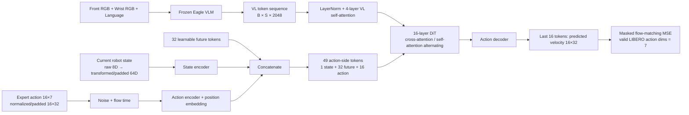

# GR00T N1.5 VLM–Action Head 데이터 흐름

작성: 2026-09-27. 대상: 현재 LIBERO-Spatial `none/step10000_bs16_adamw_bnb_8bits42` run과 gradient-first 분석.

## 1. 전체 경로



Robot state와 action은 VLM 입력이 아니다. VLM은 두 카메라 이미지와 language instruction을 결합해 vision-language token sequence를 만든다. State와 action은 action head의 별도 encoder를 통과한다.

## 2. VLM에서 넘어오는 것

`EagleBackbone`은 front/wrist image와 language를 multimodal token sequence로 처리하고 선택한 hidden layer를 그대로 반환한다.

- `backbone_features`: shape `[B, S, 2048]`
- `backbone_attention_mask`: shape `[B, S]`
- `S`는 image/text token 수이며 instruction 길이에 따라 변한다.
- 현재 80-probe cache의 실제 `S`: T0 564, T1 562, T2 559, T3 560, T4 564, T5 561.
- 하나의 pooled vector만 전달하는 구조가 아니라 image/text token 전체를 전달한다.

Action head는 이 출력을 바로 DiT에 넣지 않고 `vlln` LayerNorm과 4-layer `vl_self_attention`으로 정규화·재구성한다. Gradient 분석 figure의 `vl_projector`는 이 두 module을 묶은 이름이다. 실제로는 차원 축소 projector가 아니라 2048차원을 유지하는 VL adapter다.

현재 DiT 호출에는 attention mask가 전달되지만 `BasicTransformerBlock`의 cross-attention 호출에서는 `encoder_attention_mask` 적용 코드가 주석 처리되어 있다. 따라서 현 구현에서 해당 mask는 실질적으로 사용되지 않는다.

## 3. Loss gradient를 받는 action-head module

현재 `tune_projector=True`, `tune_diffusion_model=True` 경로에서는 action head 전체가 trainable하다. 전체 parameter 수는 1,068,806,144개다. 아래 수는 32개 embodiment용으로 할당된 전체 parameter이며, LIBERO 학습에서는 category-specific tensor의 LIBERO slice만 활성 gradient를 받는다.

| Gradient 분석 그룹 | 실제 module | 전체 parameter | 역할 |
|---|---|---:|---|
| `state_encoder` | `state_encoder` | 52,510,720 | 현재 robot state를 1개의 1536D state token으로 변환 |
| `action_encoder` | `action_encoder` + `position_embedding` | 229,785,600 | noisy 16-step action과 flow time을 16개의 1536D token으로 변환하고 순서 부여 |
| `vl_projector` | `vlln` + `vl_self_attention` | 201,437,184 | frozen VLM token을 action 생성에 맞게 정규화·재구성 |
| `future_tokens` | `future_tokens` | 49,152 | 32개의 학습 가능한 latent/future token 제공 |
| `dit` | `model` | 550,386,688 | state/future/action token을 처리하고 VLM token에 cross-attention하여 행동 velocity feature 생성 |
| `action_decoder` | `action_decoder` | 34,636,800 | DiT의 1024D 출력을 32D velocity로 변환; LIBERO에서는 mask로 7D만 loss 계산 |

Loss는 module별로 따로 존재하지 않는다. `action_decoder`가 출력한 마지막 16개 token의 velocity에 하나의 scalar masked MSE를 계산하고, chain rule로 위 여섯 그룹 전체에 역전파한다. 따라서 module heatmap은 같은 loss gradient를 parameter 위치별로 잘라 본 것이며 module별 loss나 독립적인 인과 기여도가 아니다.

## 4. Training forward

Expert action을 `a`, Gaussian noise를 `ε`, sampled flow time을 `t`라 하면:

```text
noisy trajectory x_t = (1 - t) ε + t a
target velocity v     = a - ε
```

1. Frozen VLM이 image/language token `z_vl`을 생성한다.
2. VL adapter가 `z_vl`을 정규화·self-attention한다.
3. State encoder가 현재 state를 1개 token으로 만든다.
4. Action encoder가 `x_t`, discretized `t`, action position을 16개 token으로 만든다.
5. `[1 state, 32 future, 16 action]`을 이어 49개 token으로 만든다.
6. 16-layer DiT가 짝수 block에서는 VLM token에 cross-attention하고 홀수 block에서는 action-side token끼리 self-attention한다.
7. Action decoder 출력 중 마지막 16개 token만 선택한다.
8. 실제 LIBERO action 7차원에 해당하는 mask만 적용해 `MSE(predicted_velocity, a-ε)`를 평균한다.
9. 이 scalar loss가 action head 전체로 backward된다. Frozen VLM parameter에는 optimizer update가 없다.

## 5. Rollout inference

1. 현재 front/wrist image와 instruction을 frozen VLM에 한 번 넣어 VL token을 얻는다.
2. `[B,16,32]` Gaussian action noise에서 시작한다.
3. 현재 설정의 4 denoising step마다 action encoder → 49-token 구성 → DiT cross-attention → action decoder를 실행한다.
4. 예측 velocity를 Euler update `actions ← actions + 1/4 × velocity`로 누적한다.
5. 4회 후 16×32 결과를 unnormalize하고 mask에 해당하는 16×7 LIBERO action chunk를 얻는다.
6. Rollout은 앞의 5 action만 실행한 뒤 새 관측으로 전체 과정을 다시 수행한다.

## 6. Frozen VLM의 의미와 해석 한계

현재 gradient 분석은 VLM backbone parameter를 명시적으로 freeze하고 action head 전체의 gradient를 계산했다. Checkpoint 0–5의 backbone 585개 tensor가 SHA256 기준 모두 동일한 것도 확인했다. 따라서 continual phase 사이에서 변한 것은 action head다.

그러나 frozen VLM feature 자체가 항상 task에 충분하다는 뜻은 아니다. VLM이 필요한 spatial distinction을 feature에 담지 못하면 action head만으로 해결하기 어렵다. 반대로 action head의 `vl_self_attention`은 trainable하므로 같은 frozen feature를 task마다 다르게 재해석할 수 있고, 이 부분도 forgetting의 위치가 될 수 있다.
